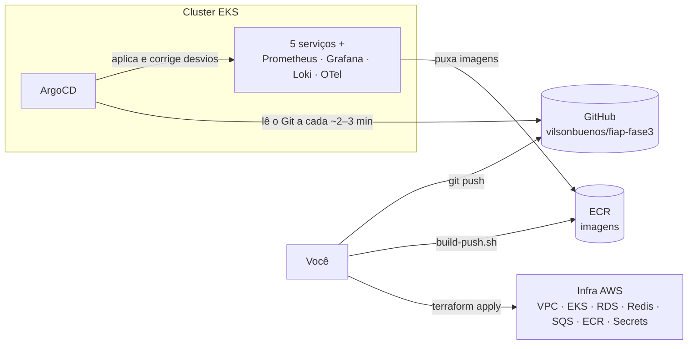

# 01 — Subir o ToggleMaster numa conta AWS nova (Fase 4)

Este guia leva uma conta AWS **vazia** até o cluster rodando os 5 microsserviços,
o ArgoCD e a stack de observabilidade (Prometheus, Grafana, Loki, OTel Collector
e exportação para o Datadog).

Tempo total: ~2h na primeira vez, sendo ~30 min esperando o `terraform apply`.
Se a cota de vCPU da conta nova estiver baixa (seção 2.8), peça o aumento **um
dia antes**.

Os comandos de terminal são para o **Git Bash**, abertos na raiz do repositório
`fiap-fase3`. Os scripts do repo são bash.

```bash
# O caminho tem "!", então use aspas SIMPLES (com aspas duplas o bash tenta
# interpretar o "!" e dá "event not found")
cd '/c/Workspace/!Internal Work/k8s/Toggle master project/fiap-fase3'
```

---

## 0. Como as peças se encaixam

Três ferramentas, cada uma com um papel:

| Ferramenta | Roda onde | Faz o quê |
|------------|-----------|-----------|
| **Terraform** | na sua máquina | cria a infraestrutura AWS: VPC, EKS, RDS, Redis, SQS, DynamoDB, ECR, Secrets Manager, IAM e os add-ons do cluster |
| **`scripts/build-push.sh`** (Docker) | na sua máquina | gera as imagens dos 5 serviços e publica no ECR |
| **ArgoCD** | **dentro do cluster EKS** | lê o repositório no GitHub e aplica no cluster os serviços e a stack de observabilidade |



O ArgoCD **não roda no GitHub**. Ele roda no cluster e busca o Git (modelo
*pull*). Ninguém faz `kubectl apply` dos serviços: para mudar algo no cluster,
você muda o Git e dá push. Detalhes na seção 11.

### O que vai existir no final

| Camada | O quê | Quem cria |
|--------|-------|-----------|
| Rede | VPC 10.0.0.0/16, 3 subnets públicas + 3 privadas, 1 NAT Gateway | Terraform |
| Kubernetes | EKS 1.35, 3 nodes `c7i-flex.large`, add-on EBS CSI, StorageClass `gp3` | Terraform |
| Dados | 3 RDS PostgreSQL 17, ElastiCache Redis (TLS), DynamoDB, SQS | Terraform |
| Segredos | Secrets Manager (bancos, Redis, chaves, Datadog, Grafana) + IRSA | Terraform |
| Add-ons | ALB Controller, KEDA, Secrets Store CSI Driver + provider AWS | Terraform (Helm) |
| Imagens | 5 repositórios ECR | Terraform; as imagens vêm do `build-push.sh` |
| GitOps | ArgoCD | `gitops/install-argocd.sh` |
| Workloads | 5 microsserviços | ArgoCD (`gitops/apps`) |
| Observabilidade | kube-prometheus-stack, Loki, otel-gateway, otel-agent, dashboard | ArgoCD (`gitops/observability`) |

### Custo

Ordem de grandeza na us-east-2 (preço on-demand, antes de créditos):

| Item | ~US$/hora |
|------|-----------|
| EKS (control plane) | 0,10 |
| 3 × c7i-flex.large | 0,25 |
| NAT Gateway | 0,045 + tráfego |
| 3 × RDS db.t3.micro | 0,05 |
| ElastiCache cache.t3.micro | 0,02 |
| ALB | 0,02 + LCU |
| **Total** | **~0,50 (≈ US$ 12/dia)** |

Suba no dia de gravar e destrua no mesmo dia (seção 15).

---

## 1. Ferramentas na sua máquina

No **PowerShell** (uma vez):

```powershell
winget install Git.Git
winget install Amazon.AWSCLI
winget install Hashicorp.Terraform
winget install Kubernetes.kubectl
winget install Helm.Helm
winget install Docker.DockerDesktop
```

Feche e abra o terminal (para o PATH atualizar). Abra o Docker Desktop e espere
ficar *Running*.

> O Docker Desktop precisa do WSL 2. Em máquina corporativa com o WSL
> bloqueado, ele não sobe: use uma máquina pessoal para a seção 10.

Confira no **Git Bash**:

```bash
git --version
aws --version          # aws-cli/2.x
terraform version      # >= 1.10
kubectl version --client
helm version
docker info --format '{{.ServerVersion}}'
```

Se ainda não configurou o Git nesta máquina:

```bash
git config --global user.name  "Seu Nome"
git config --global user.email "seu-email-do-github@exemplo.com"
```

---

## 2. Conta AWS (passo a passo no console)

### 2.1 Criar a conta

1. Acesse https://aws.amazon.com → **Create an AWS Account**.
2. E-mail do usuário root e nome da conta (ex.: `fiap-togglemaster`). Confirme o
   código enviado por e-mail e defina a senha do root.
3. *Contact information*: tipo **Personal**, preencha os dados.
4. *Billing information*: cartão de crédito. A AWS faz uma cobrança temporária
   de verificação.
5. *Identity verification*: SMS ou ligação.
6. *Support plan*: **Basic support – Free**.
7. Se aparecer a escolha **Free plan** x **Paid plan**, escolha **Paid plan**.
   Este projeto usa EKS, NAT Gateway e 3 RDS, que passam do nível gratuito de
   qualquer jeito, e o plano Free pode bloquear serviços. Os créditos de
   boas-vindas também valem no plano pago.

A ativação pode levar alguns minutos. Espere o e-mail de conta ativa.

### 2.2 Proteger o root com MFA

1. Entre como root em https://console.aws.amazon.com.
2. Canto superior direito → nome da conta → **Security credentials**.
3. *Multi-factor authentication (MFA)* → **Assign MFA device** → nome `root-mfa` →
   **Authenticator app**.
4. Leia o QR code com o Google Authenticator / Microsoft Authenticator e digite
   dois códigos seguidos.

Depois desta seção, só use o root para billing.

### 2.3 Região

Canto superior direito do console → **US East (Ohio) us-east-2**. Todo o
projeto está nessa região. Se algo "sumir" no console, confira a região primeiro.

### 2.4 Liberar billing para usuários IAM

Sem isso, o usuário IAM não vê custos nem orçamentos.

Nome da conta → **Account** → *IAM user and role access to Billing information* →
**Edit** → marque **Activate IAM Access** → **Update**.

### 2.5 Alerta de orçamento

1. Busque **Billing and Cost Management** → **Budgets** → **Create budget**.
2. **Use a template** → **Monthly cost budget**.
3. *Budget name*: `fiap-mensal` · *Budgeted amount*: `30` · *Email recipients*: seu e-mail.
4. **Create budget**.

Recomendado: crie também o template **Zero spend budget**, que avisa no primeiro
centavo fora dos créditos.

### 2.6 Usuário IAM para o Terraform

1. Busque **IAM** → **User groups** → **Create group**.
   - *User group name*: `admins`
   - *Attach permissions policies*: marque `AdministratorAccess`
   - **Create user group**
2. **Users** → **Create user**.
   - *User name*: `terraform-admin`
   - Marque **Provide user access to the AWS Management Console** →
     *I want to create an IAM user* → senha personalizada. Use este usuário
     também no console, porque só quem tem acesso ao cluster vê os pods na
     aba *Resources* do EKS (o root não vê).
   - **Next** → *Add user to group* → marque `admins` → **Next** → **Create user**.
3. Abra o usuário → aba **Security credentials** → **Create access key**.
   - *Use case*: **Command Line Interface (CLI)** → marque a confirmação → **Next**
   - *Description tag*: `git-bash-fase4` → **Create access key**
   - **Download .csv file**. Guarde fora do repositório e nunca commite.
4. Ainda em *Security credentials*, ative MFA para este usuário (mesmo processo da seção 2.2).

### 2.7 AWS CLI

```bash
aws configure --profile fiap-fase4
#   AWS Access Key ID:     (do .csv)
#   AWS Secret Access Key: (do .csv)
#   Default region name:   us-east-2
#   Default output format: json

export AWS_PROFILE=fiap-fase4
export AWS_REGION=us-east-2
aws sts get-caller-identity
# "Arn": "arn:aws:iam::<ACCOUNT>:user/terraform-admin"
```

As chaves ficam em `C:\Users\<você>\.aws\credentials`. O Terraform, o backend
S3 e os scripts usam `AWS_PROFILE`/`AWS_REGION`. Para não repetir o `export` a
cada terminal:

```bash
echo 'export AWS_PROFILE=fiap-fase4' >> ~/.bashrc
echo 'export AWS_REGION=us-east-2'   >> ~/.bashrc
```

### 2.8 Pré-checagens da conta nova

Rode todas antes do Terraform. Cada uma evita uma falha no meio do apply.

**a) Cota de vCPU on-demand.** Conta nova costuma vir com cota baixa. São 3
nodes × 2 vCPU, e o node group precisa de folga para trocar nodes:

```bash
aws service-quotas get-service-quota --service-code ec2 \
  --quota-code L-1216C47A --query 'Quota.Value'
```

Se vier **menos que 8**, peça aumento. Pode levar de minutos a um dia:

```bash
aws service-quotas request-service-quota-increase --service-code ec2 \
  --quota-code L-1216C47A --desired-value 16
```

Pelo console: **Service Quotas** → *AWS services* → **Amazon Elastic Compute
Cloud (Amazon EC2)** → busque *Running On-Demand Standard (A, C, D, H, I, M, R,
T, Z) instances* → **Request increase at account level** → `16`.

Enquanto não sai, dá para subir com 2 nodes (`-var="node_desired_size=2"` no
plan), mas a stack de observabilidade fica apertada.

**b) Tipo de instância disponível nas 3 AZs:**

```bash
aws ec2 describe-instance-type-offerings --location-type availability-zone \
  --filters Name=instance-type,Values=c7i-flex.large \
  --query 'InstanceTypeOfferings[].Location' --output text
# us-east-2a  us-east-2b  us-east-2c
```

Se faltar alguma AZ, troque `node_instance_types` para `["m7i-flex.large"]` ou `["t3.large"]`.

**c) Versão do Kubernetes em standard support:**

```bash
aws eks describe-cluster-versions \
  --query 'clusterVersions[].[clusterVersion,versionStatus,endOfStandardSupportDate]' --output table
```

O padrão do repo é `1.35`. Use uma versão com `STANDARD_SUPPORT`. Versão em
*extended support* custa 6× mais no control plane.

**d) PostgreSQL 17 disponível no RDS:**

```bash
aws rds describe-db-engine-versions --engine postgres \
  --query "DBEngineVersions[?starts_with(EngineVersion, '17')].EngineVersion" --output text
```

**e) Role de serviço do Elastic Load Balancing** (o ALB Controller precisa dela,
e numa conta nova ela ainda não existe):

```bash
aws iam create-service-linked-role --aws-service-name elasticloadbalancing.amazonaws.com
# "has been taken in this account" = já existe, tudo certo
```

---

## 3. Repositório no GitHub

O ArgoCD lê os manifests do **GitHub**, não do seu disco. Toda mudança em
`gitops/` só chega ao cluster depois de `git push`.

O repositório `vilsonbuenos/fiap-fase3` é **público** (branch `main`), então o
ArgoCD não precisa de credencial. Se um dia ele virar privado, veja a seção 11.3.

Use a pasta local que já tem as mudanças da Fase 4:

```bash
git remote -v          # origin  https://github.com/vilsonbuenos/fiap-fase3.git
git status             # mudanças da Fase 4 pendentes
```

O primeiro commit/push acontece na seção 8, depois de ajustar o account ID.

---

## 4. Bucket do state do Terraform

O state fica num bucket S3 com versionamento e criptografia; o lock é nativo do
S3 (`use_lockfile`). Nome de bucket é global, por isso entra o account ID.

```bash
ACCOUNT=$(aws sts get-caller-identity --query Account --output text)
BUCKET="tmm-tfstate-${ACCOUNT}"

aws s3api create-bucket --bucket "$BUCKET" --region us-east-2 \
  --create-bucket-configuration LocationConstraint=us-east-2
aws s3api put-bucket-versioning --bucket "$BUCKET" \
  --versioning-configuration Status=Enabled
aws s3api put-bucket-encryption --bucket "$BUCKET" \
  --server-side-encryption-configuration '{"Rules":[{"ApplyServerSideEncryptionByDefault":{"SSEAlgorithm":"AES256"}}]}'
aws s3api put-public-access-block --bucket "$BUCKET" \
  --public-access-block-configuration BlockPublicAcls=true,IgnorePublicAcls=true,BlockPublicPolicy=true,RestrictPublicBuckets=true

echo "$BUCKET"      # anote: usado no init e no destroy
```

Pelo console, o equivalente: **S3** → **Create bucket** → nome
`tmm-tfstate-<ACCOUNT>` → região us-east-2 → *Block all public access* marcado →
*Bucket Versioning*: **Enable** → *Default encryption*: **SSE-S3** → **Create bucket**.

---

## 5. Terraform: infraestrutura

### 5.1 Init

```bash
cd terraform
terraform init -backend-config="bucket=${BUCKET}"
# "Successfully configured the backend "s3"!" e "Terraform has been successfully initialized!"
```

### 5.2 Plan

```bash
terraform plan -out tfplan
```

Confira o resumo no final: `Plan: N to add, 0 to change, 0 to destroy`. Numa
conta vazia **nada** pode aparecer em *change* ou *destroy*.

Se um colega também precisar de `kubectl`, ou se a automação de self-healing
usar uma role própria, inclua os ARNs:

```bash
terraform plan -out tfplan \
  -var='eks_admin_principal_arns=["arn:aws:iam::<ACCOUNT>:user/colega"]'
```

### 5.3 Apply

```bash
terraform apply tfplan
cd ..
```

O que acontece e quanto demora (vários em paralelo):

| Etapa | Tempo | Onde acompanhar no console |
|-------|-------|----------------------------|
| VPC, subnets, NAT Gateway | ~2 min | VPC → Your VPCs (`toggle-master-vpc`) |
| EKS control plane | ~10 min | EKS → Clusters → `eks-tc3-prod-001` (*Creating* → *Active*) |
| Node group (3 nodes) | ~3–5 min | EKS → cluster → aba **Compute** |
| 3 RDS | ~8–10 min | RDS → Databases (*Creating* → *Available*) |
| ElastiCache | ~10–15 min | ElastiCache → Redis OSS caches |
| Add-ons (EBS CSI, ALB Controller, CSI driver, KEDA) | ~5 min | EKS → cluster → aba **Add-ons** |

Total: ~25–30 min.

Se o apply falhar no meio, leia o erro, corrija e rode `terraform plan -out
tfplan && terraform apply tfplan` de novo: ele só cria o que falta. Erros
comuns estão na seção 16.

### 5.4 Saídas úteis

```bash
terraform -chdir=terraform output account_id
terraform -chdir=terraform output ecr_registry
terraform -chdir=terraform output irsa_role_arns
```

---

## 6. Conferir no console da AWS

Vale um print para o relatório ("infra provisionada via IaC").

| Serviço | O que deve aparecer |
|---------|--------------------|
| **VPC** | `toggle-master-vpc`, 6 subnets, 1 NAT Gateway *Available*, 1 Internet Gateway |
| **EKS** | `eks-tc3-prod-001` *Active*; *Compute* com 3 nodes; *Add-ons* com `aws-ebs-csi-driver` |
| **EC2** → Instances | 3 instâncias `c7i-flex.large` *Running* (os nodes) |
| **RDS** | `auth-service-db`, `flag-service-db`, `targeting-service-db` *Available* |
| **ElastiCache** | `evaluation-service-redis` *Available*, criptografia em trânsito ligada |
| **DynamoDB** | tabela `ToggleMasterAnalytics` |
| **SQS** | fila `ToggleMasterQueue` |
| **ECR** | 5 repositórios `fiap-fase2/*`, ainda vazios |
| **Secrets Manager** | `auth-service/DATABASE_URL`, `auth-service/MASTER_KEY`, `flag-service/DATABASE_URL`, `targeting-service/DATABASE_URL`, `evaluation-service/REDIS_URL`, `evaluation-service/SERVICE_API_KEY`, `observability/DATADOG_API_KEY`, `observability/GRAFANA_ADMIN` |
| **IAM** → Roles | as roles IRSA: `auth-service-secrets-role`, `flag-service-secrets-role`, `targeting-service-secrets-role`, `evaluation-service-secrets-role`, `analytics-service-role`, `aws-load-balancer-controller-role`, `keda-operator-role`, `ebs-csi-driver-role`, `otel-gateway-role`, `grafana-role` |

---

## 7. Conectar no cluster

```bash
aws eks update-kubeconfig --region us-east-2 --name eks-tc3-prod-001
kubectl config current-context          # ...:cluster/eks-tc3-prod-001
kubectl get nodes                       # 3 nodes Ready
kubectl get storageclass                # gp3 (default)
kubectl -n kube-system get pods         # aws-load-balancer-controller, csi-secrets-store, ebs-csi
kubectl -n keda get pods
```

Quem tem acesso ao cluster aparece em **EKS → cluster → aba Access → IAM access
entries**. O `terraform-admin` (criador) já está lá, e os ARNs de
`eks_admin_principal_arns` também.

---

## 8. Ajustar o GitOps e publicar no GitHub

### 8.1 Account ID

Os manifests carregam o account ID em três lugares: role ARN das ServiceAccounts
(IRSA), URI do ECR e URL do SQS. O script detecta o account atual e troca em
todos os YAML de `gitops/`:

```bash
bash gitops/set-account.sh
kubectl kustomize gitops/apps/flag-service | grep -E 'image:|role-arn'
# deve mostrar o account novo
```

### 8.2 Site do Datadog

Se a sua conta Datadog **não** for do site US1 (`app.datadoghq.com`), edite
`DD_SITE` em `gitops/observability/values/otel-gateway.yaml` (tabela na seção 9).

### 8.3 Commit e push

```bash
git add -A
git status                             # confira: nada de .env, .csv ou tfstate
git commit -m "fase4: observabilidade (OTel Collector, Prometheus, Loki, Grafana) + conta ${ACCOUNT}"
git push origin main
```

---

## 9. Datadog: chave no Secrets Manager

### 9.1 Conta e site

Crie a conta Datadog (a conta gratuita *for education* indicada no curso, ou o
trial). No cadastro o Datadog pede uma região; ela define o **site**, que aparece
na URL depois do login:

| URL depois do login | `DD_SITE` |
|---------------------|-----------|
| `app.datadoghq.com` | `datadoghq.com` (padrão do repo) |
| `us3.datadoghq.com` | `us3.datadoghq.com` |
| `us5.datadoghq.com` | `us5.datadoghq.com` |
| `app.datadoghq.eu` | `datadoghq.eu` |
| `ap1.datadoghq.com` | `ap1.datadoghq.com` |

Pule o assistente de instalação do Datadog Agent: aqui quem envia os dados é o
OTel Collector.

### 9.2 API key

1. Datadog → avatar (canto inferior esquerdo) → **Organization Settings** → **API Keys**.
2. **New Key** → nome `otel-collector-fase4` → copie o valor.
   É **API key**, não *Application key*.

### 9.3 Gravar no Secrets Manager

O Terraform criou `observability/DATADOG_API_KEY` com um placeholder. A chave
real vai direto no Secrets Manager, fora do Git e do state:

```bash
read -rs DD_API_KEY          # cole e Enter (não aparece na tela)
aws secretsmanager put-secret-value --secret-id observability/DATADOG_API_KEY \
  --secret-string "$DD_API_KEY"
unset DD_API_KEY
```

Se o otel-gateway já estiver rodando, reinicie para ler a chave nova:
`kubectl -n observability rollout restart deploy/otel-gateway`.

---

## 10. Imagens no ECR

O ECR é IMMUTABLE, então a tag é o SHA do commit. O código precisa estar
commitado (seção 8.3):

```bash
git status                             # sem mudanças pendentes nos serviços
bash scripts/build-push.sh             # login no ECR + build + push dos 5, ~10 min
```

O script atualiza `newTag` em `gitops/apps/<serviço>/kustomization.yaml`.
Publique essa mudança, senão o ArgoCD continua com a tag antiga:

```bash
git add gitops/apps
git commit -m "deploy $(git rev-parse --short HEAD)"
git push origin main
```

Confira no console: **ECR** → cada repositório com 1 imagem na tag nova e
*Scan status* do *scan on push*.

---

## 11. ArgoCD

### 11.1 Ele roda direto no Git?

Não. O ArgoCD é um conjunto de pods **dentro do EKS** (namespace `argocd`). Ele
**lê** o repositório no GitHub e faz o cluster ficar igual ao que está no Git:

1. A cada **~2–3 min** (120 s + até 60 s de variação, padrão do chart) ele busca
   o branch `main` de `https://github.com/vilsonbuenos/fiap-fase3.git`.
2. Renderiza os manifests (kustomize para os serviços, Helm para a observabilidade)
   e compara com o que está no cluster.
3. Se houver diferença (`OutOfSync`), aplica sozinho (`automated`). Remove o que
   saiu do Git (`prune`) e desfaz alteração manual feita com `kubectl`
   (`selfHeal`).

Não existe uma configuração separada de "conectar o Git ao ArgoCD": o endereço
do repositório está dentro de cada *Application* (`repoURL`). O único
`kubectl apply` manual é o da **root-app**, uma vez, feito pelo script de
instalação.

O que o ArgoCD **não** faz:

- **Criar infraestrutura AWS** → Terraform.
- **Gerar imagens** → `build-push.sh` (ou um pipeline de CI).
- **Ler o seu disco** → só vale o que foi para o GitHub.

### 11.2 O que está configurado no repositório

```
gitops/bootstrap/root-app.yaml        ← aplicada à mão (1x); aponta para a pasta abaixo
gitops/bootstrap/apps/                ← cada arquivo é uma Application filha
    auth-service.yaml  flag-service.yaml  targeting-service.yaml
    evaluation-service.yaml  analytics-service.yaml        → gitops/apps/<serviço> (kustomize)
    observability-config.yaml                              → gitops/observability/config
    kube-prometheus-stack.yaml  loki.yaml
    otel-gateway.yaml  otel-agent.yaml                     → chart Helm + values do repo
```

Esse padrão se chama **App of Apps**: a root-app só cria outras Applications.
Para adicionar um componente novo, basta criar um arquivo em
`gitops/bootstrap/apps/` e dar push.

A root-app:

```yaml
apiVersion: argoproj.io/v1alpha1
kind: Application
metadata:
  name: root-app
  namespace: argocd
spec:
  project: default
  source:
    repoURL: https://github.com/vilsonbuenos/fiap-fase3.git   # repositório lido
    targetRevision: main                                       # branch
    path: gitops/bootstrap/apps                                # pasta com as Applications filhas
  destination:
    server: https://kubernetes.default.svc                     # o próprio cluster
    namespace: argocd
  syncPolicy:
    automated:
      prune: true        # apaga do cluster o que foi removido do Git
      selfHeal: true     # desfaz alterações manuais
```

Uma Application de serviço (`gitops/bootstrap/apps/flag-service.yaml`) tem o
mesmo formato, com `path: gitops/apps/flag-service` e
`syncOptions: [CreateNamespace=true]`.

Uma Application de Helm (`otel-gateway.yaml`) usa **duas fontes**: o chart vem
do repositório oficial e o arquivo de values vem deste repo:

```yaml
spec:
  sources:
    - repoURL: https://open-telemetry.github.io/opentelemetry-helm-charts
      chart: opentelemetry-collector
      targetRevision: 0.178.3                 # versão do chart, pinada
      helm:
        releaseName: otel-gateway
        valueFiles:
          - $values/gitops/observability/values/otel-gateway.yaml
    - repoURL: https://github.com/vilsonbuenos/fiap-fase3.git
      targetRevision: main
      ref: values                              # é o "$values" acima
```

Outros campos usados:

| Campo | Onde | Para quê |
|-------|------|----------|
| `argocd.argoproj.io/sync-wave` | observabilidade | ordem de criação: `-1` config, `0` Prometheus/Loki, `1` Collectors |
| `syncPolicy.retry` | observabilidade | refaz o sync com backoff se um CRD de outra Application ainda não existir |
| `ServerSideApply=true` | observabilidade | os CRDs do Prometheus Operator são grandes demais para o apply padrão |
| `CreateNamespace=true` | todas | cria o namespace de destino |
| `ignoreDifferences` | analytics-service | o KEDA altera o ScaledObject; sem isso a app ficaria `OutOfSync` para sempre |

O ArgoCD em si é instalado com os valores padrão do chart oficial `argo/argo-cd`
10.18.0 (Argo CD v3.6): sem Ingress (UI por port-forward), usuário local
`admin`, sem credencial de repositório (o repo é público).

Os charts Helm são baixados pela internet a partir do cluster (saída pelo NAT
Gateway): prometheus-community, grafana e open-telemetry.

### 11.3 Se o repositório for privado

Hoje não é necessário. Se o repo virar privado, o ArgoCD mostra
`ComparisonError: authentication required`. Para resolver:

1. GitHub → *Settings* → *Developer settings* → **Fine-grained tokens** →
   **Generate new token** → *Repository access*: só `fiap-fase3` →
   *Permissions* → *Contents*: **Read-only** → gerar e copiar.
2. Cadastrar no ArgoCD como Secret de repositório:

```bash
read -rs GH_TOKEN
kubectl -n argocd create secret generic repo-fiap-fase3 \
  --from-literal=type=git \
  --from-literal=url=https://github.com/vilsonbuenos/fiap-fase3.git \
  --from-literal=username=vilsonbuenos \
  --from-literal=password="$GH_TOKEN"
kubectl -n argocd label secret repo-fiap-fase3 argocd.argoproj.io/secret-type=repository
unset GH_TOKEN
```

### 11.4 Instalar

Pré-requisito: o push das seções 8.3 e 10 já foi feito.

```bash
bash gitops/install-argocd.sh
```

O que o script faz:

1. Mostra o contexto do `kubectl` e espera 5 s. Se não for `eks-tc3-prod-001`, aperte Ctrl+C.
2. `helm upgrade --install argocd argo/argo-cd --version 10.18.0 -n argocd --create-namespace --wait`
   (~2–3 min): sobe server, repo-server, application-controller, applicationset,
   notifications, dex e redis.
3. `kubectl apply -f gitops/bootstrap/root-app.yaml`.
4. Imprime o usuário `admin` e a senha inicial (Secret `argocd-initial-admin-secret`).

### 11.5 Acompanhar o primeiro sync

```bash
kubectl -n argocd get applications -w
```

Em 5–10 min o esperado é:

```
NAME                    SYNC STATUS   HEALTH STATUS
root-app                Synced        Healthy
observability-config    Synced        Healthy
kube-prometheus-stack   Synced        Healthy
loki                    Synced        Healthy
otel-gateway            Synced        Healthy
otel-agent              Synced        Healthy
auth-service            Synced        Healthy
flag-service            Synced        Healthy
targeting-service       Synced        Healthy
evaluation-service      Synced        Healthy
analytics-service       Synced        Healthy
```

- **Progressing**: pods subindo ou ALB sendo criado. Normal nos primeiros minutos.
- **otel-gateway/otel-agent com `SyncFailed` no começo**: o ServiceMonitor
  depende dos CRDs do kube-prometheus-stack. O `retry` refaz sozinho em até ~3 min.
- **analytics-service com 0 pods**: normal, o KEDA escala para zero com a fila vazia.

Pods direto no cluster:

```bash
kubectl get pods -A | grep -v kube-system
```

### 11.6 Interface web

```bash
kubectl -n argocd port-forward svc/argocd-server 8080:443
```

1. Abra **https://localhost:8080**. O certificado é autoassinado: *Avançado* → *Continuar*.
2. Usuário `admin`; senha impressa pelo script, ou:
   ```bash
   kubectl -n argocd get secret argocd-initial-admin-secret \
     -o jsonpath='{.data.password}' | base64 -d; echo
   ```
3. A tela inicial mostra um card por Application. Clique em **root-app** para ver
   a árvore com as 10 filhas. Clique numa filha para ver Deployment → ReplicaSet →
   Pod, com logs e eventos de cada recurso.

Botões principais de uma Application:

| Botão | O que faz |
|-------|-----------|
| **Refresh** | compara com o Git agora, sem esperar os ~3 min |
| **Hard Refresh** | idem, descartando o cache de manifests (use depois de mudar values de Helm) |
| **Sync** | aplica agora o que está no Git |
| **App Diff** | mostra a diferença entre o Git e o cluster |
| **History and Rollback** | commits já aplicados |

Recomendado: troque a senha em *User Info* → **Update Password** e depois apague
a senha inicial: `kubectl -n argocd delete secret argocd-initial-admin-secret`.

### 11.7 CLI do ArgoCD (opcional)

Baixe `argocd-windows-amd64.exe` da versão v3.6.1 em
https://github.com/argoproj/argo-cd/releases/tag/v3.6.1, renomeie para
`argocd.exe` e coloque numa pasta do PATH. Com o port-forward da 11.6 ativo:

```bash
argocd login localhost:8080 --username admin --insecure
argocd app list
argocd app get flag-service
argocd app diff flag-service
argocd app sync root-app
argocd app history flag-service
```

### 11.8 Dia a dia

- **Publicar uma mudança**: edite o Git → `git push` → em até ~3 min o ArgoCD
  aplica. Com pressa: **Refresh** na UI, ou
  `kubectl -n argocd annotate application flag-service argocd.argoproj.io/refresh=normal --overwrite`.
- **Nova versão de um serviço**: `bash scripts/build-push.sh <serviço>` → commit
  da `kustomization.yaml` → push.
- **Voltar uma versão**: `git revert <commit>` → push. Com auto-sync ligado, o
  rollback pela UI é bloqueado. O caminho é o Git.
- **Não use `kubectl edit/scale/delete` nos workloads**: o `selfHeal` desfaz em
  segundos. Isso é bom para mostrar no vídeo:
  `kubectl -n flag-service scale deploy/flag-service --replicas=0` e o ArgoCD
  volta para 1.
- **Pausar o ArgoCD** (para depurar algo à mão): desligue primeiro a root-app,
  senão ela restaura as filhas a partir do Git.
  ```bash
  kubectl -n argocd patch application root-app --type merge -p '{"spec":{"syncPolicy":{"automated":null}}}'
  kubectl -n argocd patch application flag-service --type merge -p '{"spec":{"syncPolicy":{"automated":null}}}'
  # para religar: kubectl apply -f gitops/bootstrap/root-app.yaml (ela recria as filhas com o automated do Git)
  ```
- **`helm list -A` não mostra Prometheus/Loki/OTel**: o ArgoCD renderiza os
  charts (`helm template`) e aplica os manifests; não existe release Helm. Só
  aparecem o próprio ArgoCD e os add-ons do Terraform (ALB, KEDA, CSI).

### 11.9 Problemas do ArgoCD

| Sintoma | Causa | O que fazer |
|---------|-------|-------------|
| `ComparisonError: authentication required` / `repository not found` | repo privado ou `repoURL` errado | seção 11.3; confira `repoURL` em `gitops/bootstrap` |
| A mudança não chega ao cluster | não deu push, ou ainda está no intervalo de ~3 min | `git log origin/main -1`; **Refresh** |
| `the server could not find the requested resource` (SecretProviderClass, ScaledObject) | CRD do CSI driver ou do KEDA ausente | esses vêm do Terraform: `kubectl get crd \| grep -E 'secrets-store\|keda'` |
| `ServiceMonitor`/`PodMonitor` não encontrado | kube-prometheus-stack ainda instalando os CRDs | o `retry` resolve; ou **Sync** depois que o kube-prometheus-stack ficar Healthy |
| `failed to fetch chart` | sem saída para a internet ou versão de chart inexistente | NAT Gateway *Available*; confira `targetRevision` |
| `kube-prometheus-stack` alterna `OutOfSync` | campos que o operator preenche nos CRDs | **Sync**; a Application já usa `ServerSideApply` |
| Application `Degraded` com pods `ImagePullBackOff` | tag não existe no ECR | seção 10; confira `newTag` no Git |
| Application `Progressing` por muito tempo no ingress | ALB ainda sendo criado | 2–3 min; `kubectl describe ingress -n <ns>` mostra os eventos do ALB Controller |

---

## 12. Dados iniciais dos serviços

As tabelas não existem num RDS novo, e o `evaluation-service` precisa de uma API
key emitida pelo `auth-service`. Com as 5 Applications de serviço Healthy:

```bash
bash scripts/bootstrap-app-data.sh
```

O script:

1. Roda o `db/init.sql` de auth, flag e targeting por dentro do cluster (os RDS são privados).
2. Gera a `SERVICE_API_KEY` no auth-service e grava em `evaluation-service/SERVICE_API_KEY`.
3. Cria a flag `enable-new-dashboard` com regra de 50%.
4. Espera 2 min (rotação do CSI) e reinicia o evaluation-service.

Nenhum segredo é impresso. O script pode ser rodado de novo sem problema: o SQL
é idempotente e a flag existente devolve 409.

---

## 13. Validar a aplicação

```bash
ALB=$(kubectl get ingress -n evaluation-service evaluation-service \
  -o jsonpath='{.status.loadBalancer.ingress[0].hostname}')
echo "$ALB"

curl "http://$ALB/auth/health"
curl "http://$ALB/evaluation/health"
curl "http://$ALB/evaluation/evaluate?user_id=user-123&flag_name=enable-new-dashboard"
# {"flag_name":"enable-new-dashboard","user_id":"user-123","result":true|false}
```

O ALB leva ~3 min para responder depois de criado. No console: **EC2 → Load
Balancers** → `k8s-fiapfase2prod-...` com *State* **Active** e os 4 target groups
*healthy*.

---

## 14. Observabilidade

### 14.1 Gerar tráfego

Sem requisições os painéis de taxa/erro/latência ficam vazios (os health checks
não geram spans, de propósito). Deixe rodando em outro terminal:

```bash
bash scripts/generate-traffic.sh 10         # 10 minutos
# ou: k6 run -e BASE_URL=http://$ALB load-tests-k6/teste.js
```

### 14.2 Grafana

```bash
kubectl -n observability port-forward svc/kube-prometheus-stack-grafana 3000:80
```

Usuário e senha estão no Secrets Manager (gerados pelo Terraform):

```bash
aws secretsmanager get-secret-value --secret-id observability/GRAFANA_ADMIN \
  --query SecretString --output text
```

Abra http://localhost:3000 → *Dashboards* → pasta **ToggleMaster** →
**ToggleMaster — Saúde do Ecossistema**.

### 14.3 Loki

Grafana → *Explore* → datasource **Loki**:

```logql
{service_name="evaluation-service"}
{k8s_namespace_name=~"auth-service|flag-service|targeting-service|evaluation-service|analytics-service"} | detected_level="error"
{k8s_namespace_name=~".+"} | trace_id="<cole um trace id>"
```

### 14.4 Prometheus (opcional)

```bash
kubectl -n observability port-forward svc/kube-prometheus-stack-prometheus 9090:9090
```

http://localhost:9090 → *Status* → **Targets**: kubelet, node-exporter,
kube-state-metrics, otel-gateway e otel-agent *UP*.

### 14.5 Datadog

APM → *Service Catalog* / **Service Map**, filtro `env:prod`. Os 5 serviços
aparecem em ~2 min depois do tráfego começar.

Roteiro do trecho do vídeo e prints: [03-roteiro-demo-otel.md](03-roteiro-demo-otel.md).

---

## 15. Destruir tudo

A ordem importa: o ALB e os discos EBS foram criados por controllers dentro do
cluster, não pelo Terraform. Se o cluster sumir antes, eles ficam órfãos e o
destroy da VPC trava.

```bash
# 1. Desliga o GitOps (os recursos ficam, mas param de ser recriados)
kubectl -n argocd delete application root-app
kubectl -n argocd delete applications --all

# 2. Remove ALB e discos EBS
kubectl delete ingress --all -A
kubectl delete namespace observability

# 3. Confere que o ALB e os volumes sumiram (1-2 min); as duas listas devem vir vazias
aws elbv2 describe-load-balancers --query 'LoadBalancers[].LoadBalancerName'
aws ec2 describe-volumes --filters Name=status,Values=available --query 'Volumes[].VolumeId'

# 4. Infra (~15 min)
cd terraform && terraform destroy && cd ..
```

Por último:

- **S3** → bucket `tmm-tfstate-<ACCOUNT>` → **Empty** → **Delete**. Ele é
  versionado, então `aws s3 rb --force` não basta.
- **IAM** → desative ou apague a access key do `terraform-admin` se não for usar mais.
- **Billing** → *Bills*: no dia seguinte, confira se nada continua cobrando.

---

## 16. Problemas comuns

| Sintoma | Causa provável | O que fazer |
|---------|----------------|-------------|
| `ExpiredToken` / `InvalidClientTokenId` | profile errado ou variáveis de SSO antigas no terminal | `aws sts get-caller-identity`; `unset AWS_ACCESS_KEY_ID AWS_SECRET_ACCESS_KEY AWS_SESSION_TOKEN` |
| `terraform init`: `bucket does not exist` | `BUCKET` vazio no terminal novo | refaça as duas primeiras linhas da seção 4 |
| `Error acquiring the state lock` | apply anterior interrompido | `terraform force-unlock -force <LockID-do-erro>` |
| Node group falha / `VcpuLimitExceeded` | cota de vCPU da conta nova | seção 2.8 a |
| `UnsupportedKubernetesVersion` | versão fora de suporte | seção 2.8 c e ajuste `kubernetes_version` |
| `Cannot find version 17...` no RDS | major indisponível na região | seção 2.8 d e ajuste `rds_engine_version` |
| Pod em `ContainerCreating`, evento `failed to mount secrets store objects` | IRSA com account errado ou role inexistente | refaça a 8.1 e o push; `kubectl -n <ns> get sa <sa> -o yaml` deve mostrar o account novo |
| `CreateContainerConfigError: secret ... not found` | o CSI ainda não sincronizou o Secret | espere 1 min; `kubectl -n <ns> describe pod`; no observability, `observability-config` precisa estar Synced |
| PVC do Prometheus/Loki em `Pending` | add-on EBS CSI ausente | `kubectl get sc`; `kubectl -n kube-system get pods \| grep ebs-csi` |
| Ingress sem endereço / ALB não criado | role de serviço do ELB ou subnets sem tag | seção 2.8 e; `kubectl -n kube-system logs deploy/aws-load-balancer-controller` |
| evaluation-service em CrashLoop: `conectar ao Redis` | `REDIS_URL` sem TLS | o Terraform grava `rediss://`; `terraform apply` e reinicie o deployment |
| `/evaluation/evaluate` retorna 502 | `SERVICE_API_KEY` placeholder ou flag-service fora | seção 12 |
| Pods com `ImagePullBackOff` | imagem/tag não existe no ECR | seção 10 |
| Dashboard com "No data" nos painéis de serviço | sem tráfego | seção 14.1 |
| Nada no Datadog | chave/site errados | `kubectl -n observability logs deploy/otel-gateway \| grep -i datadog`; refaça a seção 9 e confira `DD_SITE` |
| Sem logs no Loki | otel-agent fora | `kubectl -n observability get ds otel-agent`; `kubectl -n observability logs ds/otel-agent` |
| Problemas do ArgoCD | — | seção 11.9 |
