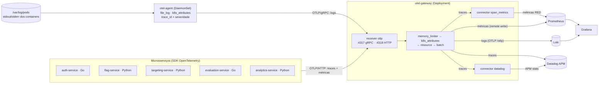

# 02 — Arquitetura do OpenTelemetry (justificativa técnica)

## Resumo (para o relatório)

> O OpenTelemetry Collector é o único ponto de entrada e saída da telemetria do
> ToggleMaster. Os cinco microsserviços usam o SDK OpenTelemetry (Go e Python) e
> enviam traces e métricas em OTLP para um Collector central (`otel-gateway`).
> Os logs de todos os containers são lidos por um Collector em cada node
> (`otel-agent`, DaemonSet), enriquecidos com metadados do Kubernetes e com o
> `trace_id` da requisição, e também chegam ao gateway por OTLP. O gateway
> processa e roteia cada sinal para o backend certo: métricas para o Prometheus
> (remote write), logs para o Loki (OTLP nativo) e traces para o Datadog APM. O
> próprio gateway gera as métricas de taxa, erro e latência a partir dos spans
> (`span_metrics`), de modo que Go e Python aparecem com os mesmos nomes no
> Grafana, e calcula as estatísticas de APM que alimentam o Service Map do
> Datadog. Trocar de backend é trocar um exporter na configuração do Collector,
> sem mexer no código das aplicações.

---

## Diagrama



---

## 1. Instrumentação nos serviços

| Serviço | Linguagem | Spans gerados | Métricas |
|---------|-----------|---------------|----------|
| auth-service | Go | servidor HTTP (`otelhttp`), queries no Postgres (`otelsql`) | `http.server.request.duration`, pool do banco |
| flag-service | Python | servidor Flask, cliente `requests` → auth, queries `psycopg2` | `http.server.request.duration`, `http.client.*` |
| targeting-service | Python | idem flag-service | idem |
| evaluation-service | Go | servidor HTTP, cliente HTTP → flag/targeting, comandos Redis (`redisotel`), **envio SQS** (span producer) | HTTP, Redis, `togglemaster.evaluation.cache` (hit/miss), `togglemaster.evaluation.decisions` |
| analytics-service | Python | **consumo SQS** (span consumer), `PutItem` no DynamoDB, `DeleteMessage` (botocore) | — |

Pontos de projeto:

- **Configuração só por variável de ambiente** (padrão OTel): `OTEL_SERVICE_NAME`,
  `OTEL_EXPORTER_OTLP_ENDPOINT`, `OTEL_RESOURCE_ATTRIBUTES`. Os Deployments em
  `gitops/apps/*/deployment.yaml` apontam para
  `http://otel-gateway.observability.svc.cluster.local:4318`.
- **Propagação W3C (`traceparent`)** entre Go e Python. O mesmo trace atravessa
  evaluation → flag → auth e evaluation → targeting → auth.
- **Propagação pela fila SQS**: o evaluation injeta o `traceparent` nos
  `MessageAttributes` da mensagem, e o analytics extrai e abre um span consumer
  filho. O trace da requisição continua até a gravação no DynamoDB, e o Service
  Map do Datadog mostra a ligação evaluation → analytics.
- **Logs correlacionados**: cada linha de log escrita durante uma requisição
  leva `trace_id=… span_id=…`. Go usa `logf(ctx, …)`
  (`*/telemetry.go`); Python usa o `LoggingInstrumentor` com
  `inject_trace_context=True` (`*/telemetry.py`).
- **Health checks fora dos traces**: kubelet e ALB batem a cada 10–30 s; esses
  spans só gerariam ruído e distorceriam a taxa de requisições.
- **Shutdown limpo** nos serviços Go (SIGTERM → `srv.Shutdown` + flush dos
  spans): um `kubectl rollout restart` do self-healing não perde os últimos
  traces.

## 2. otel-agent (DaemonSet)

Um pod por node, com acesso de leitura a `/var/log/pods`.
Values: `gitops/observability/values/otel-agent.yaml`.

| Etapa | Componente | Por quê |
|-------|------------|---------|
| Coleta | `file_log` + parser `container` (preset do chart) | lê stdout/stderr de **todos** os containers, inclusive de quem não usa OTel (ArgoCD, kube-system) |
| Metadados | `k8s_attributes` filtrado pelo próprio node | adiciona namespace, pod, deployment, container e `service.name` |
| Correlação | `transform/trace_context` | extrai `trace_id`/`span_id` do texto para os campos de trace do log record |
| Severidade | `transform/trace_context` | os serviços logam em texto puro; o nível (`error`/`warn`/`info`) é deduzido do texto para filtrar e colorir no Grafana |
| Saída | `otlp_grpc` → otel-gateway | o agent não fala com nenhum backend |

## 3. otel-gateway (Deployment)

Values: `gitops/observability/values/otel-gateway.yaml`.

### Pipelines

| Pipeline | Entrada | Processamento | Saída |
|----------|---------|---------------|-------|
| `traces` | `otlp` | `memory_limiter`, `k8s_attributes`, `resource/cluster`, `batch` | `span_metrics`, `datadog/connector`, `datadog` |
| `metrics` | `otlp`, `span_metrics` | idem + `transform/promote` | `prometheus_remote_write` |
| `metrics/datadog` | `datadog/connector` | `batch` | `datadog` |
| `logs` | `otlp` (do agent) | `memory_limiter`, `k8s_attributes`, `resource/cluster`, `batch` | `otlp_http/loki` |

### Decisões

- **Agent + gateway, e não um Collector só.** A coleta de log de arquivo precisa
  estar em cada node (DaemonSet). Já os conectores `span_metrics` e `datadog`
  são *stateful*: agregam spans em memória e precisam ver todos os spans do
  serviço na mesma instância. Por isso ficam num gateway central. O gateway também
  concentra as credenciais de saída (a API key do Datadog) num único pod.
- **`span_metrics` para RED.** As libs de Go e de Python emitem métricas HTTP
  com nomes e atributos levemente diferentes. As métricas geradas a partir dos
  spans (`traces_span_metrics_calls_total`,
  `traces_span_metrics_duration_milliseconds_bucket`) são idênticas para os
  cinco serviços e cobrem também o consumo SQS do analytics, que não é HTTP. O
  dashboard e os alertas usam essas séries.
- **Prometheus por remote write, não por scrape.** O gateway empurra as
  métricas para o `/api/v1/write` do Prometheus
  (`enableRemoteWriteReceiver: true`). O Prometheus continua fazendo o scrape
  nativo da infraestrutura (node-exporter, cAdvisor, kube-state-metrics) e das
  métricas internas dos próprios Collectors (`otelcol_*`, via
  ServiceMonitor/PodMonitor).
- **Cardinalidade sob controle.** `resource_to_telemetry_conversion` fica
  desligado: transformar todo atributo de resource em label criaria dezenas de
  labels por série (uid do pod, start time, versão do SDK…). O
  `transform/promote` copia só `service.name`, `k8s.namespace.name` e
  `k8s.pod.name`.
- **Loki via OTLP nativo** (`/otlp`, Loki 3.x). O exporter `loki` antigo foi
  descontinuado. O Loki indexa como label `service_name`, `k8s_namespace_name`,
  `k8s_pod_name`, `k8s_deployment_name`…, e guarda `trace_id`, `span_id` e o
  resto como *structured metadata*, pesquisável com `| trace_id="…"` sem criar
  stream nova por trace.
- **Datadog: exporter + connector.** O exporter `datadog` (distribuição
  *contrib*) envia os traces. O `datadog/connector` calcula as estatísticas de
  APM (hits, erros, latência por serviço/recurso) que o Datadog exige para
  montar as páginas de serviço e o **Service Map**, com
  `compute_stats_by_span_kind` e `peer_tags_aggregation` ligados para os spans
  client/producer contarem.
- **`memory_limiter` primeiro.** Se o Datadog ficar lento, o gateway recusa dado
  novo antes de ser morto por OOM.
- **Segredos fora do Git.** A API key do Datadog e a senha do Grafana estão no
  Secrets Manager e chegam aos pods pelo Secrets Store CSI Driver com IRSA: a
  role de cada ServiceAccount só lê o próprio secret. É o mesmo padrão dos
  microsserviços.
- **Tudo via GitOps.** Os charts oficiais (opentelemetry-collector,
  kube-prometheus-stack, loki) são Applications do ArgoCD com values versionados
  neste repo. Nada é instalado à mão.

### Versões

| Componente | Versão |
|------------|--------|
| OTel Collector contrib | 0.163.2 (chart `opentelemetry-collector` 0.178.3) |
| kube-prometheus-stack | 93.3.0 (Prometheus 3.16) |
| Loki | chart 7.6.0 (Loki 3.6) |
| SDK Go | `go.opentelemetry.io/otel` v1.47.0, `otelhttp` v0.72.0 |
| SDK Python | `opentelemetry-sdk` 1.45.2, instrumentações 0.66b2 |

---

## 4. Como foi validado antes do cluster

Rodamos o caminho real numa máquina local, com os binários oficiais e as configs
**renderizadas pelos charts**. Só foram trocados endpoints e retirados
`k8s_attributes` e Datadog, que dependem do cluster e da conta:

1. `otelcol-contrib validate` (0.163.2) nas configs do gateway e do agent.
2. `flag-service` real (Flask + `telemetry.py`) recebendo um `traceparent`
   externo. O span de servidor herdou o trace; a chamada ao auth levou o mesmo
   `traceparent`; o 500 gerou span com status `Error`; os health checks não
   geraram span.
3. `process_message` real do analytics com uma mensagem SQS contendo
   `traceparent`: o span consumer e os spans `DynamoDB.PutItem` e
   `SQS.DeleteMessage` ficaram no mesmo trace.
4. Gateway → Prometheus 3.16 por remote write: todas as queries do dashboard
   executadas e com os labels esperados.
5. Logs em formato CRI → agent → gateway → Loki 3.6: labels `service_name` e
   `k8s_*`, `trace_id` como structured metadata, `detected_level` correto.

Os serviços Go não puderam ser compilados localmente (toolchain bloqueado na
máquina). Eles compilam no `docker build` do `scripts/build-push.sh`.

---

## 5. Para os outros requisitos do grupo

**APM (requisito 3).** Os traces já chegam ao Datadog com `env:prod`,
`service.namespace:togglemaster` e os 5 serviços. Basta configurar a API key
(seção 9 do guia de setup).

**Alertas (requisito 4).** Séries prontas no Prometheus para a regra de exemplo
"5xx do auth-service > 5%":

```promql
100 * sum(rate(traces_span_metrics_calls_total{service_name="auth-service", span_kind="SPAN_KIND_SERVER", status_code="STATUS_CODE_ERROR"}[5m]))
    / sum(rate(traces_span_metrics_calls_total{service_name="auth-service", span_kind="SPAN_KIND_SERVER"}[5m])) > 5
```

Alternativa com o código HTTP explícito:
`http_response_status_code=~"5.."` na mesma métrica. O Prometheus seleciona
`PrometheusRule` de qualquer namespace, e o Alertmanager e o Grafana Alerting já
estão no cluster.

**Datadog vs New Relic, do ponto de vista do OTel.** O Datadog tem exporter e
connector mantidos na distribuição contrib do Collector, e o connector calcula
as estatísticas de APM no próprio pipeline. O New Relic aceitaria OTLP direto
(exporter `otlp_http`). Nos dois casos a troca fica restrita ao gateway, sem
mudar os serviços.
